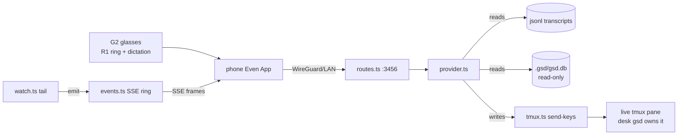

# SYSTEM BRAIN — Even G2 ↔ GSD-PI Bridge

> **Repo:** Even-g2-gsd-bridge (local: `/opt/AI_projects/Even-g2-gsd-bridge`) · **Brain version:** 1 · **Updated:** 2026-08-19
> **Last synced commit:** `ec75dca` · **Owner:** Lukáš Porubčan
> **Consumers:** AI assistants answering questions about this system. Reader has NO code access.

## 1. TL;DR

Host-side adapter that lets you **view and steer live GSD-PI coding agents from Even Realities G2 smart glasses**, hands-free, over a WireGuard tunnel. It is an Express server that speaks the official `@evenrealities/even-terminal@0.8.1` HTTP/SSE protocol, so the stock Even App (Terminal Mode) connects unmodified — no sideloading, no re-pairing. The bridge **never owns an agent**: it READS the agents' gsd-native `jsonl` transcripts + `.gsd/gsd.db`, and WRITES by injecting keystrokes/prompts into the same `tmux` panes the desk launcher (`sersám`) already drives. Runs as a systemd user service on the rig. The user (a solo developer) uses it to check "did the build pass, did it get stuck on a permission dialog, what did it just answer" and to nudge agents while on the couch, in the kitchen, or on the road — without a laptop, phone unlock, or SSH.

## 2. Architecture

| Component | Role | Tech | Where it runs |
|---|---|---|---|
| `src/index.ts` | Express app entry: `/health`, bearer-token auth, QR/token banner, starts the watcher, process resilience (`uncaughtException`, `SIGTERM`) | Node ≥20, Express 5 | rig, systemd user service |
| `src/config.ts` | env → `Config` (all defaults safe); `primaryLanIp()` for the QR URL | TS | in-process |
| `src/log.ts` | single-line structured logs + persisted `.state/last-error.json`; `DEBUG=1` = per-frame SSE tracing | TS | in-process |
| `src/server/routes.ts` | the `/api/*` even-terminal endpoints | Express | in-process |
| `src/server/events.ts` | per-session SSE 500-entry ring buffer, fan-out, replay, `emitText()` paint sequence, optimistic-echo dedupe | TS/SSE | in-process |
| `src/even/provider.ts` | the read/write split; 9-method provider surface; `statusFor` (the arming lever) | TS | in-process |
| `src/even/format.ts` | 576×288 lens shrink — collapse whitespace, drop tool noise, hard-truncate | TS | in-process |
| `src/gsd/sessions.ts` | project enumeration; `cwd` from transcript, tmux-name slugging, latest-prompt subtitle, cold-start projects | TS | reads FS |
| `src/gsd/watch.ts` | tail loop over `jsonl` → frames; next-steps menu detect; **ambient repaint** (M002); alarm push | TS | in-process timer |
| `src/gsd/questions.ts` | ANSWER-mode: parse open `tmux` picker, match spoken utterance → option index, cache next-steps menu | TS | reads tmux |
| `src/gsd/jsonl.ts` | gsd-native + Claude-Code `jsonl` line parser → turns | TS | reads FS |
| `src/gsd/progress.ts` | read-only `.gsd/gsd.db` progress + `readAutoLiveness` heartbeat verdict | node:sqlite readOnly | reads DB |
| `src/gsd/metrics.ts` | read-only milestone cost/token/elapsed + `readStopReason` | node:sqlite readOnly | reads DB |
| `src/gsd/status.ts` | `buildStatusCard` — the ≤6-line × ≤40-char lens dashboard composer | TS | in-process |
| `src/gsd/auto.ts` | `readAutoState` — heartbeat-first auto liveness (running/quiet/stopped/none) | TS | reads DB+lock |
| `src/gsd/tmux.ts` | `tmux` primitives: `send-keys`, send prompt, spawn, session probe | child_process | shells out |
| `scripts/sersam` | optional neon-TUI desk launcher; starts/resumes tmux sessions the bridge expects | bash ≥4 | rig terminal |

**How they talk:** Even App → HTTP/SSE → `routes.ts` → `provider.ts`. Reads flow from `provider` parsing jsonl/DB. Writes flow `provider` → `tmux.ts send-keys` into the live pane. The `watch.ts` tail loop pushes frames outward via `events.ts emit()` → SSE → glasses.



## 3. Data model

The bridge owns **no persistent data**. It is read-mostly against artifacts owned by desk GSD-PI; its only writes are ephemeral (`.state/` and keystrokes into tmux).

| Data | Source of truth | Where / engine |
|---|---|---|
| Agent conversation history | gsd-native `jsonl` transcripts (and Claude-Code `jsonl` for current auto-mode) | Files under `~/.gsd/sessions`, `~/.gsd/agent/sessions`, `~/.claude/projects` (all merged, newest-per-cwd wins) |
| Project cwd | The transcript's `session` line | jsonl — **never** decoded from the dir slug (slug is `/`→`-` lossy; project names contain hyphens) |
| Milestone/slice progress, cost, tokens, elapsed | `.gsd/gsd.db` | SQLite (WAL). Tables: `unit_dispatches` (started_at/ended_at), `audit_events` (`unit-metrics-snapshot` rows), milestone/slice status |
| Auto-run liveness | `.gsd/gsd.db` `workers` table (`status`, `last_heartbeat_at`, `pid`), TTL 60s | SQLite — the authoritative heartbeat; `.gsd/auto.lock` used only for `unitId`/`unitType` labels |
| Stop/fail reason | validation verdict, `notifications.jsonl`, STATE.md blocker | files/DB, resolved by `metrics.readStopReason` |
| Live SSE ring | in-memory 500-entry buffer per session | RAM — **wiped on restart** (`nextId=1`) |
| Last error | `.state/last-error.json` | file, for post-mortem diagnosis |

The bridge opens `gsd.db` **read-only** (`node:sqlite` readOnly). WAL readers are safe beside the single desk-gsd writer; a bridge write could corrupt engine state (hard constraint R007).

## 4. Data flows

**A. View a project's latest exchange**
1. Glasses open Terminal Mode → `GET /api/sessions` → 2. `listSessions` scans transcript roots, keys by cwd, newest wins, filters worktree dirs → 3. flat cross-project list sorted by mtime, title `[name] ● subtitle` (`●` live tmux, `○` offline), subtitle = **latest** user prompt → 4. wearer picks with R1 ring → `GET /api/sessions/:id/history` → 5. jsonl parsed to turns, shrunk to 576×288.

**B. Dictate a new prompt**
1. Wearer dictates → `POST /api/prompt` → 2. `provider.prompt` first checks the status-keyword intercept and next-steps expansion → 3. optimistic-echo to the ring (instant on-lens feedback) → 4. `tmux send-keys -t <project> "<text>" Enter` into the live pane → 5. if project offline and `ALLOW_SPAWN`, spawn `tmux` + `gsd` first → 6. desk gsd processes it, writes jsonl → 7. `watch.ts` tails the new answer, `emitText` paints it, `recordEcho`/`consumeEcho` drop the one duplicate replay of the wearer's own line.

**C. Answer an interactive question by voice (ANSWER-mode)**
1. gsd opens a TUI picker (flushes **no jsonl** while open) → 2. `parsePicker` scrapes the `tmux` pane (footer `esc to exit` = discriminator) → 3. `statusFor` returns `"awaiting"` → this arms the Even App's native swipe question-card → 4. wearer says a number → `matchAnswer`/`matchMulti` (digit → number word → exact label → substring) → 5. **single-select**: `send-keys <n>`, beat, `Enter`. **multi-select**: `Down×k` + `Space` per target, then `Enter` (review) + `Enter` (submit).

**D. Next-steps menu by number**
1. A gsd answer ends in a numbered menu (`Ďalej?` / `Next steps:` / trailing `Čo?`) → 2. `detectMenu` recognizes it (anchor: keyword line, `Iné`/`Other` escape, or short trailing `?`) → 3. tailer caches parsed options per session (`setLastMenu`) → 4. next prompt: `provider.prompt` expands bare `2` → `2. <label>` before forwarding, so the model can't re-read its list and re-decide → 5. one-shot, cleared on next prompt.

**E. Voice keyword dashboard (M001) + ambient self-update (M002)**
1. Wearer says whole-utterance "status"/"dashboard"/"progress" → `provider.prompt` swallows it **pre-tmux** (no agent turn, no tokens) → 2. `buildStatusCard(cwd,name)` composes the ≤6-line frame → `emitText`. **M002 push:** 3. `watch.ts` tick loop detects an auto-run state change (`progressSignature|disp` differs) → 4. re-pushes the same frame via `emitText` (gated: auto-only, glasses attached, ≥30s since last, not on an alarm tick) so the lens **self-updates** with no voice poll, plus a heartbeat so frozen ≠ quiet-but-alive → 5. on pause/stop/fail, one loud `⚠ AUTO-STOPPED` alarm carrying a human-readable reason fires once.

## 5. Integrations & external dependencies

| Integration | For | Protocol / direction | Auth | Credential location | Failure behavior |
|---|---|---|---|---|---|
| Even App / G2 firmware | The glasses UI | `@evenrealities/even-terminal@0.8.1` HTTP/SSE, bidirectional | Bearer token | `BRIDGE_TOKEN` env (in `.env`, chmod 600) | Fixed set of SSE frames; **silently drops unknown frame types** (see §9) |
| Desk GSD-PI agents | The thing being viewed/steered | Read jsonl + `gsd.db`; write via tmux send-keys | none (same-user FS/tmux) | n/a | Bridge is attach-only; if agent absent, project shows `○` offline; prompt can spawn one |
| tmux | Steering channel | `tmux send-keys` / spawn | same-user session bus | n/a | If pane missing and `ALLOW_SPAWN`, a new session is created |
| WireGuard | On-the-road transport | UDP tunnel, phone → rig LAN IP | WG keys (outside this repo) | WG config on phone/gateway | If down, glasses unreachable — no bridge-side handling |
| `.gsd/gsd.db` (SQLite) | Progress/cost/liveness | `node:sqlite`, **read-only** | n/a | file on rig | Never-throws; unreadable DB → degraded frame (omitted line), not a crash |

No cloud, no account, no third-party API. Dependencies: `express@^5`, `cors`, `qrcode-terminal`.

## 6. Security & protection

- **AuthN:** single **bearer token**. Every `/api/*` route requires `Authorization: Bearer <token>` or `?token=`. `/health` is the **only** unauthenticated route.
- **Token:** `BRIDGE_TOKEN` env. If unset, a random 16-byte hex is generated **per boot** — which forces the glasses to re-pair on every restart, so a fixed value is set in production `.env`. **Set it to a long random hex.** (No token value is stored in this repo.)
- **Network exposure:** binds `0.0.0.0:3456` so the phone reaches it over the WG-routed LAN. Intended to be reachable only on the LAN or over the WireGuard tunnel — **not** exposed to the public internet. No TLS in the bridge itself (WG provides the encrypted transport).
- **Secrets:** live in `.env` (chmod 600), loaded by the systemd `EnvironmentFile`. Only key NAMES appear in `.env.example`. ⚠ `.env.example` ships the placeholder `BRIDGE_TOKEN=change-me-to-a-long-random-hex` — a deploy that forgets to change it is a hardcoded-token risk.
- **DB safety:** read-only `node:sqlite` connection; zero writes to `gsd.db` (constraint R007) so the desk single-writer WAL is never corrupted.
- **Backups:** N/A — the bridge holds no durable data of its own; everything it reads is owned/backed-up by GSD-PI.

## 7. Processes & automation

| Process | When | Where defined | If it doesn't run |
|---|---|---|---|
| Bridge service | Boot + on-failure restart (`RestartSec=3`) | `systemd/even-g2-gsd-bridge.service` (systemd **user** service) | Glasses can't reach any agent |
| jsonl tail loop | Every `TAIL_INTERVAL_MS` (500ms) while running | `src/gsd/watch.ts` | No new answers/ambient pushes reach the lens |
| Ambient repaint + heartbeat | Inside the tail tick, ≥30s throttle (`AMBIENT_MIN_INTERVAL_MS`), auto-mode only | `src/gsd/watch.ts` (M002) | Dashboard stops self-updating; falls back to voice-keyword pull |
| CI/tests | Manual: `npm test`, `npm run typecheck` | `package.json` scripts | n/a (no CI pipeline configured) |

No crons, no n8n, no external schedulers. GSD-PI itself runs the agents; the bridge only reflects/steers them.

## 8. Operations runbook

**Install / run**
```bash
npm install && npm run build
npm start            # prints QR + token; scan in Even App → Terminal Mode
npm run dev          # tsx watch mode
```

**Deploy (systemd user service, autostart, survives reboot)**
```bash
cp .env.example .env && chmod 600 .env    # set BRIDGE_TOKEN to a long random hex
npm run build
cp systemd/even-g2-gsd-bridge.service ~/.config/systemd/user/
systemctl --user enable --now even-g2-gsd-bridge
loginctl enable-linger "$USER"            # keep running while logged out
```

**Restart / logs / health**
```bash
systemctl --user restart even-g2-gsd-bridge
journalctl --user -u even-g2-gsd-bridge -f
curl -s localhost:3456/health | jq        # uptime, live SSE clients, bind, roots, last error
cat .state/last-error.json                # persisted last error, console-free diagnosis
DEBUG=1 npm start                         # per-frame SSE tracing
```

**Common recovery**
- **Wedged / no frames:** check `/health` client count and `last-error.json`; restart the service.
- **⚠ Do NOT restart mid-capture:** restart wipes the SSE ring (`nextId=1`); the replay cursor and the glasses disagree about ids. Ask a *fresh* question after a restart.
- **Keystrokes wrong (permission/interrupt do nothing):** the `KEY_*` defaults are best-effort for the gsd TUI; run `tmux capture-pane -t <proj> -p` to see the live dialog and calibrate `KEY_PERMISSION_ALLOW/DENY/INTERRUPT`.
- **Project missing from list:** confirm a transcript exists under a configured root and cwd is under `PROJECT_ROOTS`; worktree dirs are intentionally filtered out.

**Verification gates:** `npm test` (159 tests as of M002) and `npm run typecheck` must be green.

## 9. Known quirks & gotchas

- **No `agent_message` frame type — firmware silently drops unknown frames.** Assistant text renders ONLY as a `text_delta` stream bracketed by `status:text_start`/`status:text_end`, then committed by a `result` frame. An early build emitted `agent_message`; it reached the ring but never painted. Inspect `@evenrealities/even-terminal@0.8.1 dist/claude/session.js` before inventing any frame type.
- **The paint-and-persist sequence is exact and order-sensitive:** `text_start (sessionId REQUIRED)` → `text_delta (bare — no ts/icon)` → `text_end (sessionId REQUIRED)` → `result (sessionId + text REQUIRED, commits the answer)` → `idle`. Missing `sessionId` on status = blank body; a stray field on the delta corrupts the render buffer; missing `result` = the answer flashes then clears on idle. Stats on a tailed turn are unknown and shipped as zero (shape over accuracy).
- **Never emit `tool_result`/`tool_call`.** gsd logs `content:[toolCall, text]` then flushes the matching `toolResult` on a **separate later line**. Glasses render **latest-frame-wins**, so a `tool_result` buries the answer, and deriving status from the trailing line falsely re-flips a finished turn to `busy`. Derive status from the **last assistant message** in the chunk. Tool activity is intentionally not surfaced (would need firmware-known `tool_start`/`tool_end`).
- **The native swipe question-card arms off status, not the frame.** `statusFor` must return `"awaiting"` for a pending picker; the App keys card mode off the `/api/sessions` poll status, not the `user_question` frame alone (proven: frame-only commit `4ea2999` had no effect until `awaiting`-status commit `98fd1c1`). Plain-text numbered "next steps" prose never paints a card — to surface the card the agent must ASK via the `ask_user_questions` tool, not type a prose list.
- **Auto liveness must come from the DB `workers` heartbeat, not the lock pid.** The `auto.lock` pid is the persistent interactive `gsd` TUI (always alive while the terminal is open), so `pidAlive(lock.pid)` can never distinguish "auto running" from "auto stopped, TUI open". GSD moved liveness to the `workers` table (`status='active' AND last_heartbeat_at >= now-60s`). Using the lock pid produced a **false ticking clock** after `/gsd stop`. Fix shipped `bddb310`/`5f99047`. A stale heartbeat with a live worker pid reads as **"quiet"**, not a false "stopped".
- **Stale `unit_dispatches` rows:** the DB keeps never-closed rows (`ended_at` NULL) from dead runs; naive elapsed math shows week-long counters. `metrics.readMilestoneMetrics` counts only the MAX(id) open row and only when the caller passes `live:true` (running/quiet).
- **Subtitle must read the LATEST user prompt** (tail window, back-to-front), not offset 0 — reading the first froze the list subtitle at the session's first command.
- **cwd is lossy from the slug** — always read it from the transcript `session` line.
- **Regex `\b`/`\w` are ASCII-only** — `\b` after `é` (in `Ďalej`) fails; menu detection uses an explicit delimiter class instead.
- **Lens glyphs are monochrome BMP only.** Safe: `→ ▶ » • ● ○ ★ ─ [x]`. Tofu: all `✓ ✗` dingbats and all color emoji. Size gotcha: `▸` (U+25B8) paints but is too tiny — use `▶` (U+25B6).
- **SSE ring wiped on restart** — see runbook. Content frames dropped with no live client are logged as warnings, not silently swallowed.
- **`gsd_validate_milestone` false-downgrade:** any milestone/slice criteria text containing the bare words `snapshot` or `screenshot` trips the browser-evidence gate and silently downgrades a `pass` to `needs-attention`. Escape: record a `uatType: runtime-executable` UAT with a real `gsd_uat_exec` evidence row.
- ⚠ **`.env.example` ships a placeholder token** (`change-me-to-a-long-random-hex`) — must be replaced on deploy.

## 10. Decision log

- **D001 — Dashboard hooks into the existing `isStatusCommand` intercept** (provider.ts), widen keywords + rewrite `buildStatusCard`, same swallow-pre-tmux + `emitText` path. *Rationale:* half the feature already exists; instant, no agent turn, no live tmux needed. New endpoint/agent-forward rejected. *(collaborative)*
- **D002 — Cost/token/duration in a new read-only `metrics.ts` beside `progress.ts`**, `node:sqlite` readOnly, sourced from `audit_events unit-metrics-snapshot` + `unit_dispatches`; active-task elapsed from DB not bridge memory. *Rationale:* different concern than progress parsing; DB-sourced elapsed survives restarts with zero in-memory state. *(agent)*
- **D003 — Dashboard trigger is keyword-only, swallowed at the bridge:** whole-utterance "status"/"dashboard"/"progress", never forwarded to gsd, no auto-refresh/push. *Rationale:* on-demand, zero tokens, agent never interrupted; whole-utterance rule protects real prompts containing "status". *(human)*
- **D004 — Frame content:** milestone-scoped `$ · tok · elapsed` (no ETA); blocker replaces the active-task line when present; idle keeps the same frame with `○IDLE` tag + STATE.md `Next:` on line 5. *Rationale:* ETA is guessy while future slices unplanned; blocker is urgent; one dense frame preserves muscle memory. *(human)*
- **D005 — Line-1 liveness tag** (`▶RUN/◌QUIET/⚠STOP/○IDLE`) from `readAutoState` (DB worker heartbeat + worker pid), never the lock pid; quiet (stale beat + live pid) reads as working. *Rationale:* carried from shipped fix `5f99047`; TTL alone false-stops healthy runs; glasses are the sole view, so err toward running/quiet. *(human)*
- **D006 — Frame micro-format:** line-1 percent = `floor(((slicesDone + tasksDone/tasksTotal)/slicesTotal)×100)` (completed-work only); line 2 collapses a leading contiguous complete run to `✓ S01-S07`; every degrade is line-omission, never a thrown error or placeholder. *Rationale:* roadmap example numbers were illustrative; tests pin exact strings; only completed work counts (stale open dispatch rows and mid-unit cost are invisible). *(agent, display-only revisable)*
- **D007 — Make the pull-only dashboard push-driven inside the existing `watch.ts` `tick()` loop** (M002), right after `detectAutoAlarm`. Emit `buildStatusCard` via `emitText` ONLY when all hold: (1) `autoLiveness !== "none"` (auto-only, inverse of firehose gate); (2) `sessionHasClients` (glasses attached — opposite of alarms which fill the ring while dark); (3) composite signature `progressSignature(prog)|disp` changed (excludes elapsed/cost drift by design); (4) `now - lastPushAt >= 30_000` (stacking backstop). Suppress the repaint on the exact alarm tick (the loud one-liner owns that edge) but still advance the stored signature. *Rationale:* triggers already computed in `tick`; a separate module/timer would duplicate the project scan and liveness read; signature-not-string dedup + min-interval + client-gate bound appended cards to a few per unit on the append-only lens; R001 keyword pull path stays byte-for-byte unchanged, ambient is purely additive. *(agent)*

## 11. Glossary

- **Bridge** — this project; the host-side even-terminal ↔ GSD adapter.
- **G2** — Even Realities G2 smart glasses (monochrome 576×288 lens, R1 ring input, dictation mic).
- **Even App** — the phone app in Terminal Mode that pairs with the glasses and speaks the SSE protocol to the bridge.
- **GSD / GSD-PI** — Git Ship Done, the coding-agent workflow system whose agents this bridge views/steers (opengsd.net).
- **sersám / sersam** — the bundled neon-TUI desk launcher (`scripts/sersam`) that starts/resumes the tmux sessions the bridge expects; the project list is a "live mirror of sersám".
- **Terminal Mode** — the Even App mode that speaks the even-terminal HTTP/SSE protocol.
- **ANSWER-mode** — the bridge's mechanism that collapses every interactive question to "say a number".
- **Ambient repaint / Ambient Lens Cockpit (M002)** — the push-driven self-updating dashboard frame.
- **Firehose / transcript firehose** — streaming jsonl entries to the lens; gated to interactive (non-auto) sessions so auto runs stay silent.
- **Liveness verdict** — `running` / `quiet` / `stopped` / `none`, derived from the DB `workers` heartbeat.
- **Heartbeat TTL** — 60s window; a worker is live iff `status='active' AND last_heartbeat_at >= now-60s`.
- **emitText** — the function that ships a whole answer as the correct paint-and-persist frame sequence.
- **Ďalej? / Čo? / Iné** — Slovak for "Next? / What? / Other"; anchors that mark a trailing next-steps menu.
- **Optimistic echo** — instantly reflecting the wearer's own dictated prompt to the ring, later de-duped against the jsonl replay.
- **Cold-start project** — a dir under a root that has never run gsd; listed with a synthetic `cold_…` sessionId; first prompt spawns tmux+gsd.
- **Tofu** — the □ box the lens renders for an unsupported glyph.

## 12. FAQ (assistant-optimized)

**Q: What does this bridge actually do?**
A: It lets you view and steer live GSD-PI coding agents from Even G2 glasses. It reads the agents' transcripts and injects your dictated prompts into their tmux panes, over the official Even terminal protocol.

**Q: Does the bridge run the coding agents?**
A: No. It is attach-only. The desk `gsd` process stays the sole owner of each transcript and tmux pane; the bridge just reads and types into them. It never becomes a second writer.

**Q: Why did my answer show status and prompt but a blank body on the glasses?**
A: Almost always the paint sequence. The firmware needs `text_start` (with sessionId) → bare `text_delta` → `text_end` (with sessionId) → a `result` frame that commits the answer → `idle`. Missing sessionId, a stray field on the delta, or a missing `result` each blanks the body.

**Q: Why must I never emit a `tool_result` frame?**
A: The glasses render latest-frame-wins, and gsd flushes the toolResult on a line *after* the answer — so emitting it buries the answer that just painted. Tool activity is intentionally not shown.

**Q: The glasses clock kept ticking after I stopped GSD auto. Why, and is it fixed?**
A: Fixed (`bddb310`/`5f99047`). The old code judged liveness by the `auto.lock` pid, which is the always-alive interactive TUI. It now reads the DB `workers` heartbeat (TTL 60s); within one TTL window of a stop the status flips idle and the ticker freezes.

**Q: Where does the cost / token / elapsed number on the dashboard come from?**
A: `metrics.ts` reads `.gsd/gsd.db` — `audit_events` `unit-metrics-snapshot` rows aggregated, and `unit_dispatches` started_at/ended_at for elapsed. It shows completed-unit totals honestly and does not pretend real-time cost (snapshot rows lag the active unit).

**Q: Why is there no ETA on the frame?**
A: Deliberate (D004). Future slices are often unplanned, so an ETA would be guessy. The frame shows milestone-scoped `$ · tok · elapsed` only.

**Q: How do I make the native swipe question-card appear on the glasses?**
A: The agent must ask via the `ask_user_questions` tool (a real TUI picker). The card arms when `statusFor` returns `"awaiting"` — the App keys card mode off the `/api/sessions` poll status. A prose "next steps" list will never paint a card.

**Q: Why does saying "2" to a next-steps menu run option 2 reliably, but saying "2" mid-answer sometimes didn't?**
A: For a *menu* the bridge caches the parsed options and expands `2` → `2. <label>` before forwarding, so the model can't re-read its list and re-decide. That expansion is one-shot, cleared on the next prompt.

**Q: Single-select vs multi-select pickers — how are they answered?**
A: Single-select binds digit shortcuts: `send-keys <n>`, beat, `Enter`. Multi-select digits are inert (checkboxes) — the bridge walks `Down×k` + `Space` per target, then `Enter` (review) + `Enter` (submit).

**Q: Where do I change the port or bind address?**
A: `PORT` / `BIND_HOST` env (defaults `3456` / `0.0.0.0`). Set in `.env`, loaded by the systemd EnvironmentFile.

**Q: Where is the auth token and why does re-pairing keep happening?**
A: `BRIDGE_TOKEN` env. If it's unset, a random token is generated on every boot, which forces the glasses to re-pair after each restart. Set a fixed long random hex in `.env`.

**Q: Is the bridge safe to expose to the internet?**
A: No. It's meant for the LAN or over WireGuard. Only `/health` is unauthenticated; everything else needs the bearer token, but there's no TLS in the bridge itself — WireGuard provides the encrypted transport.

**Q: Can the bridge corrupt the GSD database?**
A: No, by design. It opens `gsd.db` read-only (`node:sqlite` readOnly), which is WAL-safe beside the single desk-gsd writer. Zero writes is a hard constraint (R007).

**Q: What breaks if I restart the bridge while an answer is being captured?**
A: The SSE ring is wiped (`nextId=1`), so the replay cursor and the glasses disagree about frame ids and you may lose that answer. Restart between captures, then ask a fresh question.

**Q: A project isn't showing up in the glasses list. Why?**
A: It needs a transcript under a configured session root and a cwd under `PROJECT_ROOTS`. Worktree dirs (`.gsd/worktrees/…`) are intentionally filtered out. If it exists on disk but never ran gsd, it appears as a cold-start entry.

**Q: How do I change which project directories are exposed?**
A: `PROJECT_ROOTS` env (default `/opt/AI_projects`). Only projects under those roots are listed.

**Q: The permission/interrupt keystrokes don't work. How do I fix them?**
A: The `KEY_PERMISSION_ALLOW/DENY/INTERRUPT` defaults are best-effort for the gsd TUI. Run `tmux capture-pane -t <proj> -p` to see the live dialog and set the right keys in `.env`.

**Q: What is the "quiet" liveness state?**
A: A running worker whose heartbeat is momentarily stale but whose pid is alive. The bridge shows it as working (`◌QUIET`), not a false "stopped" — heartbeat cadence is per-unit while the TTL is 60s, so TTL alone would false-stop a healthy run.

**Q: What does M002 (Ambient Lens Cockpit) add over M001?**
A: M001 made the dashboard appear when you say "status" (pull-only). M002 makes it **push-driven**: it repaints itself on auto-run state changes plus a heartbeat, fires a one-shot alarm with a reason on pause/stop/fail, supports answering a blocked question mid-pause, and lets you say/type a resume command from the glasses.

**Q: How do I resume a paused auto run from the glasses?**
A: Say or type the resume command; the bridge normalizes a matched resume utterance to `/gsd auto` (`resumeCommand`, override via `RESUME_COMMAND`) and forwards it via `POST /api/prompt` into the live tmux pane. The input gate opens because `statusFor` returns `idle` on paused/stopped.

**Q: Why does milestone M002 validation say "needs-attention" if all tests pass?**
A: Only the physical live-lens wearer UAT is outstanding — a tracked, deliberate deferral (the sandbox can't drive the mic or force a real auto-pause pane). All bridge-layer criteria pass: `tsc` clean, 159/159 tests green. (Also beware the validation gate false-downgrades on the bare words `snapshot`/`screenshot` — see quirks.)

**Q: Where's the protocol reverse-engineering documented?**
A: `docs/PROTOCOL.md` (frame types, paint triad, glyph limits, ring/replay). Read it before touching the emit path. Architecture is in `docs/ARCHITECTURE.md`; the liveness fix write-up is `docs/AUTO-LIVENESS-FIX.md`.

**Q: What are the transcript roots, and why three?**
A: `~/.gsd/sessions` (interactive TUI), `~/.gsd/agent/sessions` (older auto-mode), and `~/.claude/projects` (current gsd-pi auto-mode in Claude-Code jsonl format). All are scanned and merged, newest-per-cwd wins, and `parseLine` normalizes the Claude-Code shape so the live run surfaces.

**Q: What language is some of the UI text in?**
A: Slovak. The owner runs gsd with Slovak prompts, so menu anchors like `Ďalej?` (Next?), `Čo?` (What?), and `Iné` (Other) are recognized alongside English.

## 13. Brain changelog

- 2026-08-19 — commit `ec75dca` (initial, up to M002 S05) — all sections created. CREATE mode from README + docs/{ARCHITECTURE,PROTOCOL,AUTO-LIVENESS-FIX}.md, `.gsd` PROJECT/REQUIREMENTS/DECISIONS (D001–D007, R001–R011), M001+M002 roadmaps/validation, config.ts, and project memory.
